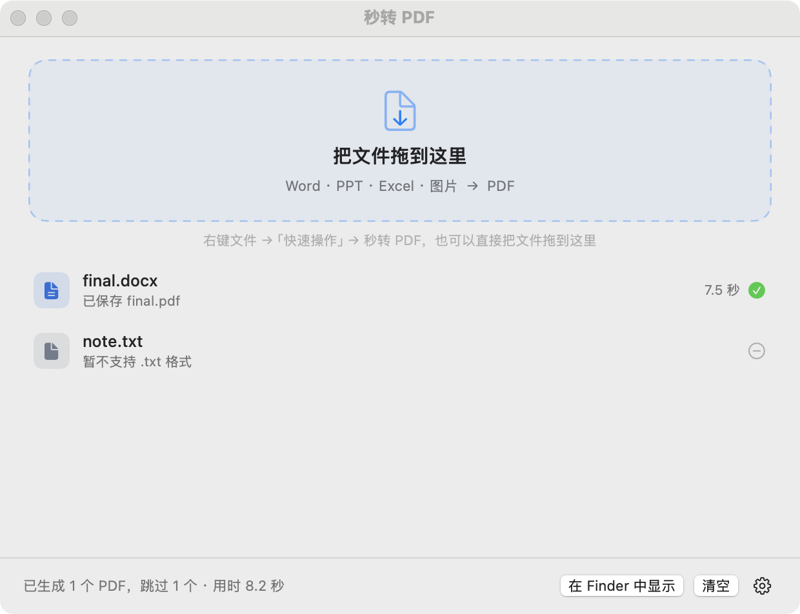

# 秒转 PDF

把 Word、PPT、Excel、图片直接变成 PDF，**不打开文档，也不用等 Office 启动**。
右键文件，或者在小小的窗口里拖进去，几秒钟后 PDF 就出现在原文件旁边。



> **独立版**：LibreOffice 转换引擎已经打包在应用里，由 Swift 直接调用。
> 目标 Mac 不需要安装 DeepSeek Harness、LibreOffice、Node.js 或 Office，装好即可离线使用。

---

## 下载哪个版本

| 你的 Mac | 下载 |
| --- | --- |
| Apple Silicon（M1 / M2 / M3 / M4） | `秒转 PDF（Apple Silicon）.zip` |
| Intel 芯片 | `秒转 PDF（Intel）.zip` |

在「  → 关于本机」里可以看到芯片型号。

## 安装

1. 解压下载的 zip。
2. 右键 `安装.command` → **打开**（第一次会被 macOS 拦一下，右键打开即可）。
3. 看到「✓ 安装完成」就好了。

如果提示「无法验证开发者」：
- 右键 `安装.command` → 打开；
- 或到 **系统设置 → 隐私与安全性**，点「仍要打开」；
- 或者在「终端」里执行，然后再右键打开：

  ```bash
  xattr -dr com.apple.quarantine "/路径/安装包（Apple Silicon）"
  ```

装好后：

- 应用在 `~/Applications/秒转 PDF.app`
- 右键快速操作在 `~/Library/Services/秒转 PDF.workflow`
- 临时文件和日志在 `~/Library/Application Support/PDFQuick/`

## 怎么用

### 右键（最快）

Finder 里选中一个或多个文件（也可以选文件夹），右键 → **快速操作** → **秒转 PDF**。

### 拖进小窗口

打开「秒转 PDF」，把文件拖进虚线框，或点虚线框选择文件。

### 拖到程序坞图标

把文件拖到 Dock 上的「秒转 PDF」图标，效果和右键一样。

PDF 生成在源文件旁边，同名自动编号（`报告.pdf`、`报告 (1).pdf`…）；
不需要编号可以在齿轮里勾选「覆盖同名 PDF」。原文件不会被改动。

## 支持哪些格式

| 类型 | 格式 |
| --- | --- |
| Word | `.doc` `.docx` `.odt` |
| PowerPoint | `.ppt` `.pptx` `.odp` |
| Excel | `.xls` `.xlsx` `.ods` |
| 图片 | `.png` `.jpg` `.jpeg` `.heic` `.heif` `.tif` `.tiff` `.bmp` `.gif` `.webp` |

- PDF 会被跳过；`.pages` / `.key` / `.numbers` 暂不支持，列表中会标出来。
- 一批文件按顺序转换，转换期间窗口会显示每个文件的进度。

## 第一次转换请点「允许」

macOS 会询问是否允许访问「文稿 / 桌面 / 下载」文件夹，点 **允许**。
转换全部在本机完成，**不联网、不上传文件**。

如果误点了「不允许」：**系统设置 → 隐私与安全性 → 文件与文件夹 → 秒转 PDF** 里重新勾选。

## 它是怎么工作的

```
秒转 PDF.app/
└── Contents/Resources/engine/
    ├── bin/dsoffice              # LibreOffice 引擎（无窗口，MPL-2.0）
    ├── program/                  # 引擎运行所需的 LibreOffice 资源
    ├── licenses/                 # 许可证与第三方声明
    └── sources/                  # 引擎构建脚本（MPL-2.0 源码可得性）
```

- Word / PPT / Excel：应用把文件复制到自己的临时目录，直接启动 `dsoffice` 转换，拿到 PDF 再搬回原文件夹，转换结束引擎就退出。
- 图片（png/jpg/heic 等）走 macOS 自带的 `sips`，不启动引擎，几乎瞬间完成。
- 一批多个文件按顺序转换，单个文件通常 2–5 秒（首次约 10–20 秒）。

## 从源码构建

需要 Xcode Command Line Tools（`swiftc`）。首次构建先下载引擎（约 330 MB，只需一次，不需要 Node/npm）：

```bash
./fetch-engine.sh    # 从 npm 下载 @deepseek-ai/libreoffice-kit 预编译包到 vendor/
./build.sh           # 编译通用二进制，产出 dist/安装包（Intel|Apple Silicon）+ 两个 zip
./build.sh --host-only   # 只打当前架构，开发调试更快
```

也可以直接装到本机：

```bash
./install.sh         # 装 dist 里当前架构的安装包到 ~/Applications
./uninstall.sh
```

版本升级：改 `fetch-engine.sh` 顶部的 `NODE_VERSION` / `KIT_VERSION`，重跑两个脚本。

发布到 GitHub（Release 附件、公证、Homebrew）见 [docs/PUBLISH.md](docs/PUBLISH.md)。

## 目录结构

```
pdf-quick-standalone/
├── fetch-engine.sh          # 下载 LibreOffice 引擎预编译包
├── build.sh                 # 编译 + 组装 + 打两套安装包
├── install.sh / uninstall.sh
├── src/
│   ├── app/                 # SwiftUI 应用（窗口、拖拽、任务列表、引擎调用）
│   ├── installer/           # 安装.command / 卸载.command / 安装说明
│   ├── icon/make-icon.py
│   └── workflow/            # 生成 Finder 快速操作
├── vendor/                  # 引擎预编译包（构建产物，可重建）
└── dist/                    # 安装包（构建产物）
```

## 常见问题

**右键菜单里没有「秒转 PDF」？**
1. 确认 `~/Library/Services/秒转 PDF.workflow` 存在（重跑 `安装.command` 会重建）。
2. 执行 `pbs -flush`，或注销后重新登录。
3. 右键时看「快速操作」子菜单，而不是「服务」。

**转换失败？**
齿轮 →「打开转换日志」，里面会有引擎返回的具体原因。加密/有密码的文档需要先取消密码。

**第一次转换慢？**
第一次要启动引擎并建字体缓存，通常 10–20 秒；之后同一批文件每个 2–5 秒。

**会被杀毒软件拦吗？**
应用是 ad-hoc 签名（没有 Apple 开发者证书），所以首次打开需要右键 →「打开」。
如果你有 Apple Developer ID，可以在 `build.sh` 里改成正式签名并公证，用户体验更好。

## 许可证

- 应用本身：MIT。
- 转换引擎：`@deepseek-ai/libreoffice-kit` 与 LibreOffice，MPL-2.0。
  分发时保留 `Contents/Resources/engine/licenses/` 下的许可证与第三方声明。
- 源码地址：<https://github.com/deepseek-ai/dsh-libreoffice-kit>
